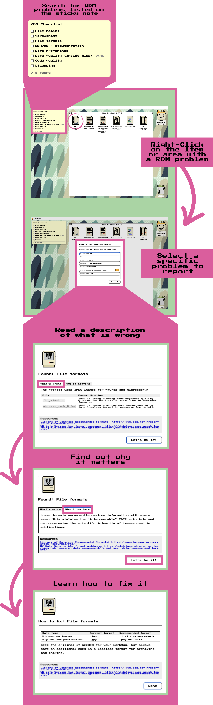

[](https://doi.org/10.5281/zenodo.22206717)

# RDM Classic

A browser game that teaches Research Data Management by handing you a genuinely
terrible research project and asking you to find everything wrong with it. It
looks like a System 7 Finder desktop, with some artistic liberties taken.

The project belongs to a fictional alpine soil study. A folder window is already
open when the game loads, and most of what is in it violates at least one RDM
principle.

[Play the beta](https://chasenunez.github.io/RDM_CLASSIC/) ·
[Report a bug](https://github.com/chasenunez/RDM_CLASSIC/issues)

Built as a hands-on companion to the Lib4RI **Basics of Research Data
Management** workshop.



## How you play

- **Right-click** (or long-press) a file icon and choose **Report an RDM
  problem**. Get it right and a dialog explains what is wrong, why it matters,
  and how to fix it.
- **Double-click** a file to open it. Spreadsheets render as tables, code as
  numbered lines, images as images. Some problems are only visible inside a
  file, so right-click the offending cell or line.
- **Click "Add a file"** in the strip at the top of the project window, or
  right-click empty space, for a list of things a good project should have, and
  report whichever you think is missing. Picking one reports it directly. Watch
  out: some entries on that list are already in the project. The button exists
  because the right-click was undiscoverable, and because nothing wires a
  long-press to the empty space, so on a touch screen it is the way in. It is
  the one coloured control in the window for the same reason.
- Opening the messy spreadsheet starts a **minigame**. It has nine separate
  data-quality faults and you have to find all of them before it gets cleaned
  up. Everything else is fixed one problem at a time.
- Fixing a problem changes the project immediately. Files get renamed,
  converted, sorted into folders, or pulled back out of the Trash.
- A sticky note tracks your progress through the ten problem categories. Wrong
  guesses are counted but never block you.

Progress saves to `localStorage` as you go, and the Apple menu has a **Reset
Game** if you want a clean run. There is no server, no database and no login.
The whole thing is static files that any web host can serve, and that constraint
drove most of the design.

## Running it locally

You need **Node 20.19+ or 22.12+** (a Vite 8 requirement) and npm 9 or later.

```bash
git clone https://github.com/chasenunez/RDM_CLASSIC.git
```

```bash
cd RDM_CLASSIC && npm install && npm run dev
```

That serves the game at `http://localhost:5173/RDM_CLASSIC/`. The sub-path is
deliberate: `vite.config.ts` sets `base: '/RDM_CLASSIC/'` so the build works on
GitHub Pages, and the dev server matches it.

Everything the game needs is committed here. There are no external downloads and
no content-generation step, so a fresh clone runs as-is. To change the game, edit
the committed files directly and reload.

The other scripts:

| Command | Does |
|---------|------|
| `npm run typecheck` | `tsc --noEmit`. Worth running constantly; it catches most data-file mistakes |
| `npm run check-data` | Checks the data files against each other. Catches what the types can't; see [Checking the data](#checking-the-data) |
| `npm run build` | Bundles everything into `dist/` |
| `npm run preview` | Serves the built `dist/` so you can check it before deploying |

## Running it in a container

For long-term maintenance there is a Docker image that packages the toolchain,
the build, and a web server together, so the game runs without a Node install:

```bash
docker build -t rdm-classic . && docker run --rm -p 8080:8080 rdm-classic
```

See [DOCKER.md](DOCKER.md) for the full instructions, including what to do when
the code changes. The container is independent of the GitHub Pages deploy below;
both work, and neither affects the other.

## Deploying

Two workflows watch the repo, and they are deliberately independent: the one
below publishes, and
[`type-and-data-checks.yml`](.github/workflows/type-and-data-checks.yml) reports
type and data errors without being able to hold a deploy back.

**The repo deploys itself.** Pushing to `main` runs
[`.github/workflows/deploy.yml`](.github/workflows/deploy.yml), which does
`npm ci`, `npm run build`, and publishes to GitHub Pages. Nothing to do by hand.

`dist/` is a build artifact and is **not** committed; it is in `.gitignore`. If
you find it in the index again, something has gone wrong.

To host it elsewhere, run `npm run build` and serve the generated `dist/`. It is
self-contained, so Netlify, Vercel, nginx, or an S3 bucket with static hosting
will all serve it without configuration. Change `base` in `vite.config.ts` to
`'/'` first if you are serving from a domain root.

## How the game is wired

Four things have to line up for a click to do anything:

| Part | Path | Role |
|------|------|------|
| **The file on disk** | `public/files/sample_project/…` | The actual bytes a viewer loads, served at `/files/sample_project/…` |
| **The file tree** | `src/data/file-tree.json` | Makes the file appear as an icon and picks its viewer. **If a file isn't here, it isn't on screen.** |
| **The problem** | `src/data/problems.json` | The teaching content (`what` / `why` / `fix` / `resources`) revealed on a correct find |
| **The mapping** | `src/data/mapping.json` | Connects a click target, or a named missing artifact, to a problem `id` |

Something only counts as a finding when a mapping trigger matches it *and* the
problem `id` it names exists in `problems.json`. A file with no trigger is a
harmless decoy. A trigger pointing at a file that isn't in `file-tree.json` is an
unreachable problem, which has bitten this project before.

The TypeScript is an engine that reads those three JSON files. A whole new puzzle
can be added without opening a `.tsx`.

### Adding a file with a problem attached

**1. Put the file in** `public/files/sample_project/`. Keep whatever name you
want shown; spaces and odd characters are usually the point.

**2. Register it in `src/data/file-tree.json`** so it renders. `path` is relative
to `public/files/`, `name` is the bare filename:

```jsonc
{
  "path": "sample_project/lab_notebook.txt",
  "name": "lab_notebook.txt",
  "type": "file",
  "size": 1234,                       // cosmetic, doesn't need to be exact
  "mimeGuess": "text/plain",
  "icon": "/icons/Text file.svg",     // any name from public/icons/manifest.json
  "viewerType": "text"
}
```

`viewerType` decides both how a double-click opens the file and which triggers
you can hang on it:

| `viewerType` | Use for | Supports triggers |
|--------------|---------|-------------------|
| `text` | `.txt`, `.py`, `.r`, `.sh` | `file`, `line` |
| `markdown` | `.md`, and the fake `.docx` files, which are really Markdown | `file` |
| `csv` | `.csv` | `file`, `cell` |
| `xlsx` | `.xlsx` | `file`, `cell` |
| `image` | `.jpg`, `.png`, `.tif` | `file` |
| `binary` | `.dat` and other opaque blobs | `file` |

**3. Make sure the problem exists** in `src/data/problems.json`. Reuse an id like
`file-naming`, or add an object with `id`, `name`, `fullTitle`, `what`, `why`,
`fix`, and `resources`.

**4. Wire the click to the problem** in `src/data/mapping.json`:

```jsonc
{
  "id": "my-new-problem",
  "triggers": [
    { "type": "file", "path": "lab_notebook.txt" },
    { "type": "line", "path": "lab_notebook.txt", "line": 4 }
  ],
  "matchRule": "any"
}
```

Triggers always use the **bare filename**, never the nested path. One file can
carry several triggers, and one problem can have triggers across several files.

**5. Check it.** Run `npm run typecheck`, then `npm run check-data`, then
`npm run dev` and find the thing yourself. The app reads the JSON at runtime, so
there is nothing to regenerate.

### Putting a file in a subfolder

The folder window shows root-level files plus folder icons. There are two ways a
file ends up in a subfolder.

**A subfolder that exists from the start.** Add a `folder` entry to
`file-tree.json` and give the file a nested `path`; the folder name is the part
of `path` after `sample_project/`. Put the real file at the matching location on
disk.

**A subfolder that appears as a reward.** This is what the game actually does.
`FIX_ACTIONS[ORGANIZING_PROBLEM_ID].organize` in `src/lib/fixActions.ts` maps
folder names to file names, and when the player fixes `folder-organization`
those files move into `_sub/<folder>/…` and the folder becomes openable. Names
are matched *after* a file has been renamed by its own fix, so list the fixed
name:

```ts
organize: {
  'data':        ['raw_alpine_soil_data.xlsx', 'my_new_data.csv'],
  'figures':     ['20260420_AlpineSoil_Fig1_RatioBySite_v1.0.png', … ],
  'manuscripts': [ … ],
  'code':        [ … ],
},
```

### Making a fix change the project

`src/lib/fixActions.ts` decides what happens to the folder when a problem is
fixed. Each problem `id` maps to a `FixAction`:

- `remove`: filenames to hide from the folder view
- `archive`: filenames to move into the `archive/` window, and a subset of `remove`
- `add`: new `FileEntry` objects to show. Set `virtual: true`. They are fetched
  from `public/files/` by path, so the file has to exist on disk if it opens in a
  viewer
- `organize`: only on `folder-organization`, the subfolder map above

> A file already in `file-tree.json` must **not** also appear in a fix's `add`
> array, or it renders twice afterwards. `computeDisplayFiles` deduplicates
> within `add` but not against the base tree. Use `add` only for files that do
> not exist until a fix happens.

### Before you commit

- [ ] File exists under `public/files/sample_project/…`
- [ ] Entry in `src/data/file-tree.json` with the right `viewerType`
- [ ] Problem `id` exists in `src/data/problems.json`
- [ ] Trigger in `src/data/mapping.json` uses the bare filename and a real `id`
- [ ] `npm run typecheck` and `npm run check-data` both pass, and you can find
      the thing in `npm run dev`

## Trigger reference

`src/data/mapping.json` is the bridge between what the player clicks and which
problem that reveals. Hand-edited, committed, and the source of truth.

| Type | Fires when | Fields |
|------|-----------|--------|
| `file` | Right-clicking a file icon | `path`, the bare filename |
| `cell` | Right-clicking a cell in the CSV or XLSX viewer | `path`, `row` (0-indexed from the top of the file), `col` (0-indexed) |
| `line` | Right-clicking a line in the text viewer | `path`, `line` (1-indexed) |
| `project-absence` | Picking an item from the "Report something missing" list | `name`, the artifact id (`README.md`, `LICENSE.md`, `folders`, `.git`), and `label` for the menu |
| `desktop` | Nothing. No problem uses it | none |

`matchRule: "any"` means one matching trigger is enough. It is the only supported
value. Entries can also carry a `comment`, which is ignored at runtime and exists
so the reasoning behind a trigger set sits next to the triggers.

### Reporting something that isn't there

`project-absence` is the odd one out, because there is nothing on screen to
click. The player picks the artifact by name from the empty-space menu and that
pick *is* the guess, graded immediately by `matchMissingArtifact`. There is no
follow-up "which problem is it?" dialog, because naming the artifact and naming
the problem would be the same answer twice.

On its own that would make the menu a list where every entry scores, so
`mapping.json` also carries `missingArtifactDecoys`: things a good project needs
that this project already has. Reporting one is a wrong guess, and `present`
tells the player where the thing actually is.

```jsonc
"missingArtifactDecoys": [
  {
    "name": "decoy-analysis-code",
    "label": "The analysis code",
    "present": "script.py is in the project folder. It has plenty wrong with it, but it is not missing."
  }
]
```

`getMissingArtifactMenu()` merges the real absences with the decoys and sorts by
label so the two interleave; listing the real ones first would give the answer
away by position. Found entries drop out. Keep the decoy count in the low single
digits, enough that the menu has to be read but not so many that the real ones
are a slog to find.

### One rule worth not breaking

**Anything the game highlights must be reportable.** `XlsxViewer` tints
suspicious cells and `TextViewer` hints at lines that carry triggers. A tinted
cell reads as an invitation, so a highlight with no matching trigger charges the
player a wrong guess for spotting something real. That drifted once already and
cost twenty cells in the minigame spreadsheet. The reverse is fine and
deliberate: the ambiguous `col1` / `col2` headers are reportable but unstyled,
because noticing them is the whole exercise. If you widen `cellClass`, widen the
triggers to match.

## Checking the data

`npm run check-data` runs [`scripts/check-data.mjs`](scripts/check-data.mjs),
which asserts the things the type system cannot see. Every rule in it exists
because breaking it produces a game that still compiles, still loads, and is
quietly wrong somewhere a player will eventually stand.

| Check | What it catches |
|-------|-----------------|
| `files-on-disk` | A file-tree entry or a fix's `add` naming a file that isn't in `public/files/`, or an `icon` that isn't in `public/` |
| `duplicate-add` | A fix adding a file the base tree already has, which renders it twice |
| `archive-subset` | A fix archiving a file it never removed, so it shows up in two windows |
| `trigger-reachable` | A trigger on a file nothing provides, or a `cell` trigger on a text file |
| `problem-ids` | `mapping.json` or `FIX_ACTIONS` naming a problem that isn't in `problems.json`, and any problem or sub-problem that no trigger can reach |
| `missing-menu` | Two problems claiming the same absence, or a decoy colliding with a real one |
| `organize-map` | A bucket with no folder, or a name listed before its own fix renames it |
| `fixed-project-tidy` | A file still loose at the top level once every problem is fixed |
| `learn-path` | A learn-mode step naming a file or a problem that doesn't exist. Skipped on branches without `src/data/learn-path.json` |

The script reads `src/lib/fixActions.ts` by compiling it with the repo's own
TypeScript, rather than restating the fix rules in JavaScript. A second copy of
those rules could agree with itself and still be wrong about the game. The
compiled output goes to `node_modules/.cache/rdm-check/`, which is ignored.

CI runs this and `npm run typecheck` on every push, on every branch, through
[`.github/workflows/type-and-data-checks.yml`](.github/workflows/type-and-data-checks.yml).
That workflow only reports: it is separate from the deploy, so a red mark there
never stops the site going out. If you would rather it did, add it to the branch
protection rules for `main` instead of wiring it into `deploy.yml`.

## Project structure

```
RDM_CLASSIC/
├── public/
│   ├── files/                   # the sample project, names kept verbatim
│   ├── icons/                   # SVG icons plus manifest.json
│   ├── downloads/               # RDM_Guide.html, offered at the end of the game
│   └── fonts/                   # Press Start 2P, hosted locally so it works offline
├── src/
│   ├── components/
│   │   ├── Desktop.tsx          # desktop, folder view and its info strip, window rendering
│   │   ├── MenuBar.tsx          # top menu bar
│   │   ├── Window.tsx           # draggable, resizable, focusable window chrome
│   │   ├── FileIcon.tsx         # file icon; double-click opens, right-click reports
│   │   ├── BreakableLabel.tsx   # inserts <wbr> so long filenames wrap sensibly
│   │   ├── ContextMenu.tsx      # the report menu, and the missing-artifact list
│   │   ├── StickyNote.tsx       # the checklist
│   │   ├── TitleSlide.tsx       # click-to-start screen
│   │   ├── WelcomeDialog.tsx    # instructions, as a mid-90s IM conversation
│   │   ├── RulesDialog.tsx      # the same rules, available any time from the menu bar
│   │   ├── ProblemSelectionDialog.tsx  # pick which problem you're claiming
│   │   ├── ProblemReportDialog.tsx     # correct find: what, why, then how to fix
│   │   ├── WrongGuessDialog.tsx # wrong guess, or something already found
│   │   ├── BossBattleIntro.tsx  # minigame opening card
│   │   ├── BossBattleComplete.tsx      # minigame victory card
│   │   ├── CompletionDialog.tsx # shown once every problem is found
│   │   └── viewers/
│   │       ├── TextViewer.tsx   # numbered lines, right-click or long-press
│   │       ├── MarkdownViewer.tsx      # rendered through marked
│   │       ├── CsvViewer.tsx    # table with reportable cells
│   │       ├── XlsxViewer.tsx   # SheetJS parse, sheet tabs, the minigame grid
│   │       ├── ImageViewer.tsx  # centred image
│   │       ├── GifViewer.tsx    # the Trash easter eggs
│   │       └── BinaryViewer.tsx # hex dump; wired up, but no sample file uses it yet
│   ├── data/
│   │   ├── problems.json        # hand-edited: the teaching content
│   │   ├── file-tree.json       # hand-edited: what the desktop shows
│   │   └── mapping.json         # hand-edited: click to problem
│   ├── lib/
│   │   ├── matchTrigger.ts      # the referee; matches targets and grades guesses
│   │   ├── fixActions.ts        # what each fix does to the project
│   │   ├── layout.ts            # window centering and the project-folder layout
│   │   ├── useFileContent.ts    # the one fetch hook every viewer shares
│   │   ├── asset.ts             # prefixes URLs with BASE_URL for GitHub Pages
│   │   ├── persistence.ts       # localStorage read and write
│   │   ├── longPress.ts         # touch long-press, standing in for right-click
│   │   ├── windowManager.ts     # drag clamping
│   │   └── sounds.ts            # chime, bonk, sosumi and fanfare, via Web Audio
│   ├── styles/
│   │   ├── reset.css
│   │   ├── fonts.css            # font-family custom properties
│   │   └── mac.css              # all the System 7 chrome; palette in the :root block
│   ├── theme.ts                 # window sizes, asset paths and UI labels in one place
│   ├── types.ts                 # shared interfaces
│   ├── GameContext.tsx          # all state: one reducer plus localStorage
│   ├── App.tsx                  # root component, overlays, end sequence
│   └── main.tsx
├── scripts/
│   └── check-data.mjs           # npm run check-data: the invariants above
├── index.html
├── vite.config.ts
├── tsconfig.json
└── package.json
```

## Design notes

Three decisions shaped everything else.

**The game is data, not code.** What exists, what is wrong with it, and what a
click reveals all live in the three JSON files above. The TypeScript interprets
them. This is why adding a puzzle is a data edit.

**One state object, one reducer.** Found problems, fixed problems, wrong guesses,
open windows and the mute flag live in a single `PersistedState`, managed by a
`useReducer` in `GameContext.tsx` with eleven named actions. A one-line
`useEffect` writes the whole object to `localStorage` after every change, and
that is the entire save system. The storage key is versioned
(`rdm-scavenger-hunt:v5`) so saves that reference retired problem ids, or file
names that have since changed, get discarded rather than half-loaded.

Ephemeral UI state, meaning which dialog is up and what the player just
right-clicked, stays in ordinary `useState` and deliberately does not go in the
reducer. Keeping "game progress" separate from "what is on screen this second"
is the state decision the rest of the app leans on.

**Everything is a window.** The folder, the Trash, every viewer and the animated
GIFs are all the same `Window` component with different children. A window is
just `{id, title, viewerType, x, y, width, height, zIndex}` in an array, and a
`switch` on `viewerType` picks the contents. Focus means "highest zIndex":
clicking one stamps it with `nextZIndex++`, so nothing is ever sorted or
reordered.

Dependencies flow one way, and nothing on the left imports anything on the right:

```
types.ts ──► data/*.json ──► lib/ (pure functions) ──► GameContext ──► components ──► App
```

A few smaller things worth knowing before you change them:

- **Fixes never mutate anything.** `file-tree.json` is frozen.
  `computeDisplayFiles(baseTree, fixedProblems)` derives the current folder
  contents on every render by replaying each fixed problem's `FixAction`. Save,
  reload and undo all fall out of that for free, because the state is only ever a
  list of ids.
- **The fixed project obeys the rules it teaches.** Every file the fixes
  produce follows `YYYYMMDD_ProjectName_DocumentType_Version.extension`, with
  two deliberate exemptions that the teaching text names out loud: `README.md`
  and `LICENSE.md` keep their conventional names, because those exact words are
  what people and tools look for, and the recovered raw file keeps the name it
  arrived with, because that name is part of its provenance. If you add a fix
  that produces a file, name it to the pattern or add it to the exemptions in
  `TOP_LEVEL_BY_DESIGN` and say why. `fig1.png` used to be a third, undeclared
  exemption, and reviewers rightly read it as an oversight.
- **Renaming a displayed file means bumping the storage key.** A window is
  persisted by file *name*, so a save from before a rename reopens a window
  pointing at a file that no longer exists. `STORAGE_KEY` in
  `lib/persistence.ts` is at `rdm-scavenger-hunt:v5` for exactly that reason.
- **The fix button's verb follows the work.** A problem solved by writing a
  file that does not exist yet says *Let's write one!*; everything else says
  *Let's fix it!*. The set lives in `WRITTEN_FROM_SCRATCH` in `lib/fixActions.ts`
  and holds exactly `no-readme` and `no-license`. The folder structure and the
  Git repository are also absent, but there you are reorganising and tracking
  work that already exists, so "fix" is the honest word.
- **`public/assets` holds only what something references.** Unused variants
  (`*_old*`, a duplicated logo, a 19 MB alternate title hero) were deleted, which
  took the folder from 29 MB to 7.5 MB. `npm run check-data` fails if a file
  entry's `icon` is missing, so pruning further is safe; nothing checks the
  decorative art in `theme.ts`, so check that by eye.
- **`matchTrigger.ts` has no React in it.** It is the only genuinely
  game-specific algorithm, and keeping it pure means you can reason about the
  grading rules without rendering anything.
- **`App.tsx` has a modal traffic cop.** Several dialogs can become eligible in
  the same instant, so `MODAL_ORDER` decides which single one renders and the
  automatic end-of-game popups wait a second so they do not flash in on top of
  each other.
- **Some constants are duplicated in CSS on purpose.** `MENU_BAR_H`, the minimum
  window size, and the sticky-note dimensions in `lib/layout.ts` all have to
  match `mac.css`. Each one carries a comment saying so.
- **Sounds are synthesised at runtime**, about twenty lines of oscillator and
  gain envelope each. No audio files anywhere in the repo.

## Licence

| Component | Licence |
|-----------|---------|
| Source code | MIT, see [LICENSE](LICENSE) |
| Graphics and icons | Original artwork by Chase Núñez. [CC BY-ND 4.0](https://creativecommons.org/licenses/by-nd/4.0/): reuse with attribution, no modifications. See [LICENSE-GRAPHICS.md](LICENSE-GRAPHICS.md) |
| Press Start 2P | OFL 1.1, by CodeMan38 |

Teaching content is adapted from the Lib4RI **Basics of Research Data
Management** workshop answer key.
